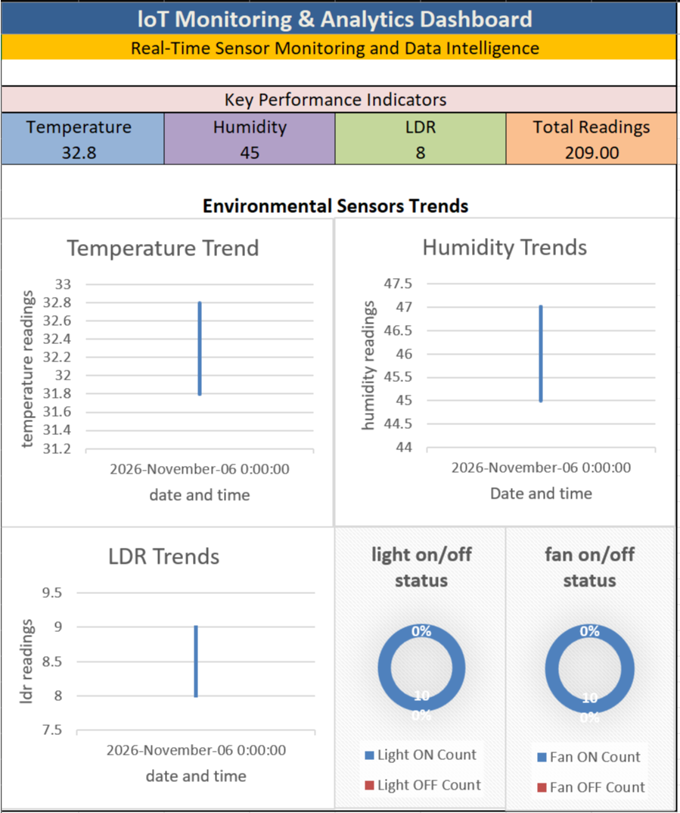

# IoT Monitoring & Analytics Dashboard

[](https://1drv.ms/x/c/1cb72b16f52dc456/IQDjHFDnwslAQ4_fmDIWelybAUFZgOt10BkPU928jFPQuNU?e=rT7fKr)

An ESP8266-based IoT monitoring system that collects temperature, humidity, ambient light, and device states, stores the readings in Excel, and presents a real-time analytics dashboard.

## Interactive Dashboard

<iframe
  width="402"
  height="346"
  frameborder="0"
  scrolling="no"
  src="https://1drv.ms/x/c/1cb72b16f52dc456/IQTjHFDnwslAQ4_fmDIWelybAagU6xWA45i9Tw6dXyC6ep4?em=2&amp;wdAllowInteractivity=False&amp;ActiveCell='Dashboard'!A1&amp;wdHideGridlines=True&amp;wdHideHeaders=True&amp;wdInConfigurator=True">
</iframe>

## Features

- Live ESP8266 sensor data collection
- Timestamped temperature and humidity readings
- Ambient light (`LDR`) monitoring
- Light and fan status tracking
- Automatic Excel table expansion
- KPI summary for the latest readings
- Environmental sensor trend charts
- Raw data, analytics, and dashboard views in one workbook

## Dashboard Sheets

| Sheet | Purpose |
| --- | --- |
| `Raw_Data` | Timestamped sensor readings and light/fan states |
| `Analytics` | Calculated summaries and analytical values |
| `Dashboard` | KPIs and environmental sensor trends |

The current workbook includes 209 readings and reports values such as temperature, humidity, LDR, and total readings.

## Project Files

| File | Description |
| --- | --- |
| `ESPconnection.py` | Tests and monitors the ESP8266 connection |
| `esptoexcel.py` | Collects readings and appends them to `IoT_Analytics.xlsx` |
| `IoT_Analytics.xlsx` | Excel workbook containing raw data and dashboard views |
| `assets/dashboard-screenshot.png` | README preview for the interactive dashboard |
| `LICENSE` | MIT license |

## Requirements

- Python 3.10 or newer
- An ESP8266 device exposing sensor data over HTTP
- Microsoft Excel or another workbook viewer
- Python packages:

```text
requests
openpyxl
```

## Installation

Clone or download this repository, then install the dependencies:

```powershell
python -m pip install requests openpyxl
```

## ESP8266 Configuration

The scripts expect the ESP8266 JSON endpoint at:

```text
http://192.168.0.228/data
```

Change `ESP_URL` in both Python scripts if the device has a different IP address:

```python
ESP_URL = "http://YOUR_ESP8266_IP/data"
```

The endpoint should return JSON in this format:

```json
{
  "temperature": 32.8,
  "humidity": 45,
  "ldr": 8,
  "lightState": "ON",
  "fanState": "OFF"
}
```

## Usage

### Test the ESP8266 connection

```powershell
python ESPconnection.py
```

This script prints each reading every 3 seconds and reports connection or JSON errors.

### Collect data into Excel

```powershell
python esptoexcel.py
```

The collector:

1. Creates `IoT_Analytics.xlsx` if it does not exist.
2. Requests sensor data from the ESP8266 every 5 seconds.
3. Adds a timestamped row to `Raw_Data`.
4. Expands the `IoT_Data` Excel table.
5. Continues until stopped with `Ctrl+C`.

> Close the workbook in Excel before starting the collector to avoid an Excel file-lock conflict.

## Excel Dashboard

Open `IoT_Analytics.xlsx` and select the `Dashboard` sheet. The dashboard uses the workbook data to show:

- Current temperature
- Current humidity
- Current LDR value
- Total readings
- Environmental sensor trends

The workbook can be refreshed and opened in Excel or viewed through the interactive OneDrive link above.

## Troubleshooting

| Problem | Resolution |
| --- | --- |
| `ESP8266 connection error` | Confirm that the ESP8266 is powered on and reachable on the configured IP address |
| `Invalid JSON received` | Check the ESP8266 `/data` response and verify that it is valid JSON |
| `Excel file is locked` | Close `IoT_Analytics.xlsx`, then restart the collector |
| `IoT_Data table not found` | Restore or recreate the `IoT_Data` table in the `Raw_Data` sheet |

## License

This project is licensed under the [MIT License](LICENSE).